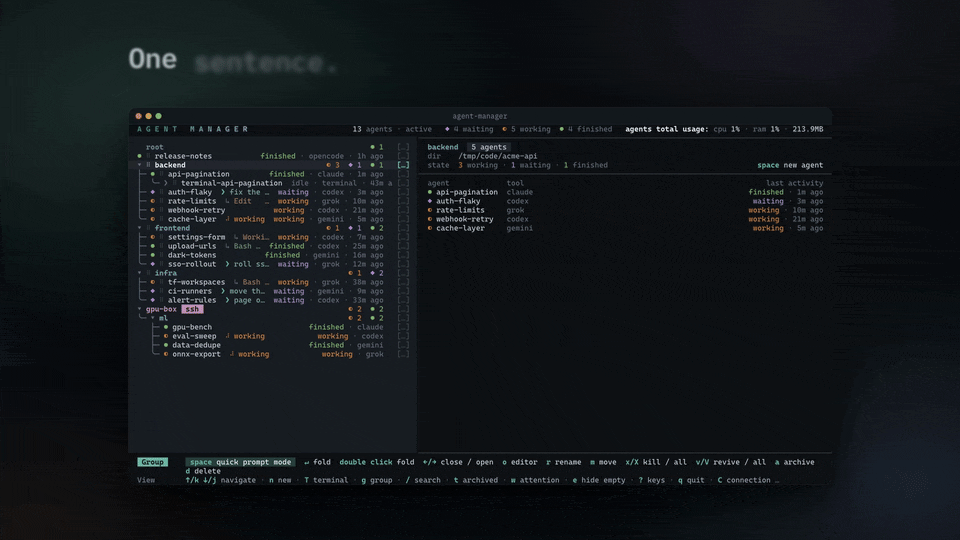
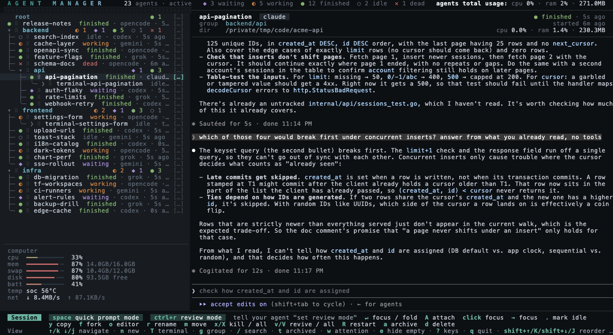
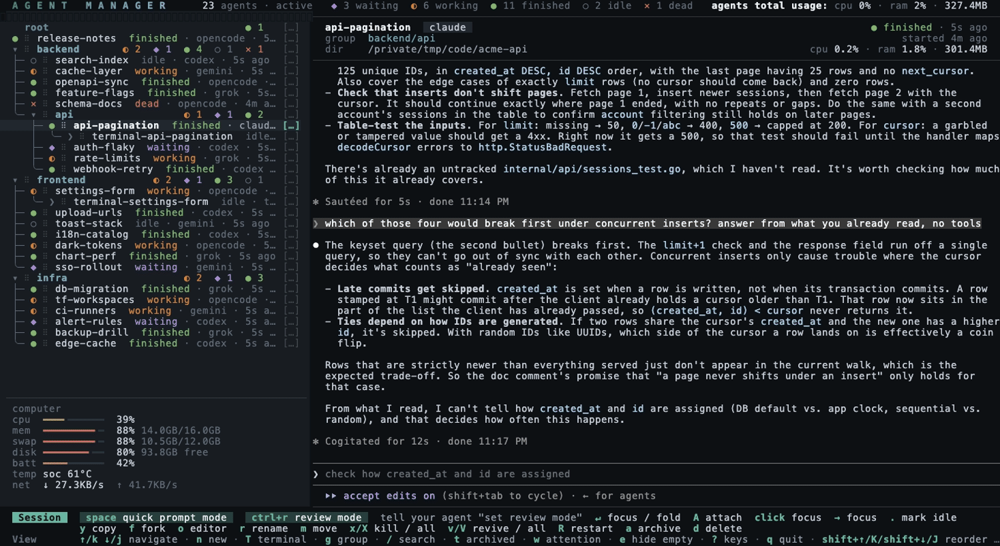
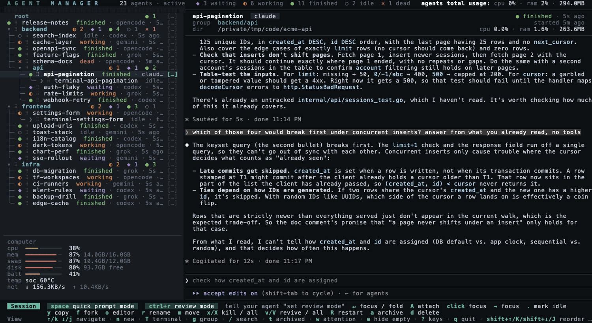
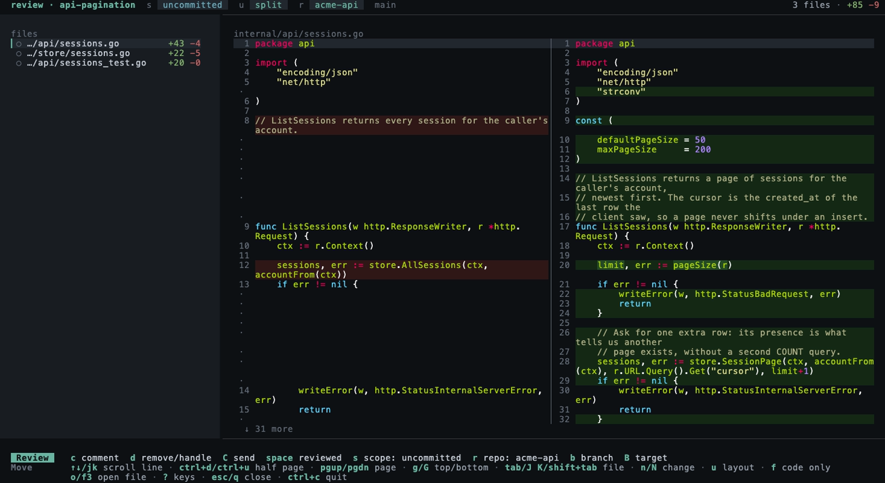

<h1 align="center">
  <picture>
    <source media="(prefers-color-scheme: dark)" srcset="docs/brand/wordmark-dark.svg">
    
  </picture>
</h1>

<p align="center"><b>あらゆる AI コーディングエージェントのための、最速の開発ワークフロー。</b></p>

<p align="center">agent manager は、今お使いのサブスクリプションとツールにそのままつながるローカルのターミナルアプリです。</p>

<p align="center">
  <a href="README.md">English</a> · <a href="README.zh-CN.md">简体中文</a> · 日本語
</p>

<p align="center">
  <a href="https://peerlist.io/yoanwai/project/agent-manager" target="_blank" rel="noopener noreferrer">
    <picture>
      <source media="(prefers-color-scheme: dark)" srcset="docs/brand/peerlist-laurel-dark.webp">
      
    </picture>
  </a>
</p>

<p align="center">
  <a href="https://trendshift.io/repositories/89312?utm_source=trendshift-badge&amp;utm_medium=badge&amp;utm_campaign=badge-trendshift-89312" target="_blank" rel="noopener noreferrer"></a>
  <a href="https://www.producthunt.com/products/agent-manager?utm_source=badge-featured&amp;utm_medium=badge" target="_blank" rel="noopener noreferrer"></a>
</p>

<p align="center">
  <a href="https://github.com/YoanWai/agent-manager/stargazers"></a>
  <a href="https://github.com/YoanWai/agent-manager"></a>
  <a href="https://github.com/YoanWai/agent-manager/releases/latest"></a>
  <a href="https://discord.gg/ecS88An7pF"></a>
  <br>
  <a href="https://github.com/YoanWai/agent-manager/actions/workflows/ci.yml"></a>
  <a href="https://app.codecov.io/gh/YoanWai/agent-manager"></a>
  <a href="https://pkg.go.dev/github.com/YoanWai/agent-manager"></a>
  <a href="LICENSE"></a>
</p>



> この文書は英語版 [README](README.md) の翻訳です。内容が異なる場合は英語版が正となります。

Claude Code、Codex、OpenCode、Grok、Gemini CLI、Antigravity CLI、Pi、Command Code、Hermes Agent、Muse Code、Oh My Pi、Cursor CLI を並べて動かせます。各ツールはそれぞれ専用の永続 tmux セッションで動きます。

agent-manager は、すでにお使いの CLI の上にかぶせる薄いレイヤーです。各セッションは、インストール済みのツールをそのまま起動します。ログイン、サブスクリプション、設定ファイル、MCP サーバー、ツールが備える機能はすべて引き継がれ、普通のターミナルで使うときとまったく同じように動きます。

どのエージェントが終わってどれが止まっているのか、ターミナルのタブを探し回る必要はありません。すべてのセッションがライブのステータス付きで 1 つのリストに並び、折りたたみや並べ替えができるプロジェクトツリーにまとまります。セッションに入らなくても返信できます。`space` を押すと、プロンプトをセッションのペインに直接送るか、選択中のグループで新しいエージェントを起動できます。終了したセッションは `v` で元の会話のまま復帰します。`ctrl+r` は、エージェントが変更したファイル全体の diff をシンタックスハイライト付きで開きます。行に残したコメントは、`C` を押すと 1 つのレビュープロンプトにまとめてエージェントのペインへ送られます。

セッションで `f` を押すと、その会話を名前付きの別セッションに分岐して続けられます。

マネージャー全体でマウスが使えます。ホイールでカーソルが動き、セッションをクリックするとフォーカス、その行かマウスの戻るボタンをクリックすると戻ります。行のハンドル（Advanced では `⠿`、Compatible では `=`）をドラッグすると並べ替えや別グループへの移動ができ、各行末の `[…]` で操作メニューが開きます。リストとプレビューの境界線もドラッグできます。未読のメッセージがある間は、キー凡例の `messages` をクリックすると開きます。フォーカス中のペインでは、ドラッグでテキストを選択してコピーし、リンクをクリックするとブラウザで開きます。ターミナル本来の選択を使いたい場合は、設定でマウスをオフにできます。設定 → **symbols** で、**Advanced** の幾何記号（デフォルト）と **Compatible** の ASCII 記号をライブプレビューで切り替えられます。

![Advanced モードの幾何記号でのマウスのデモ。ホイールでカーソル移動、クリックでセッションにフォーカスと復帰、⠿ ハンドルで並べ替え、[…] で行の操作](docs/demo-mouse.gif)

エージェントと一緒に使うツールも同じリストに並びます。`T` は選択中のエージェントやグループの下にシェルを開くので、ビルド、Git、ちょっとしたコマンドに使えます。エージェントは別のエージェントを起動し、メッセージを送り、完了まで待つことができます。MCP 対応のセッションには、起動時からそのためのツールが入っています。

名前付きの指示を設定に保存して、新規セッションのフォーム、クイックプロンプト、フォーカス中のセッション、`spawn --saved`、`send --saved`、`create_session` から再利用できます。詳しくは [Saved prompts](docs/usage.md#saved-prompts) を参照してください。

まだないもの：コストの集計。

**ジャンプ：** [インストール](#インストール) · [使い方](#使い方) · [キー](docs/usage.md#keys) · [Diff レビュー](docs/usage.md#diff-review) · [設定](docs/configuration.md) · [ドキュメントサイト](https://agent-manager.dev/docs/)

## 対応ツール

ステータス検出は **Claude Code**、**OpenCode**、**Codex**、**Grok Build**、**Gemini CLI**、**Antigravity CLI**、**Pi**、**Command Code**、**Hermes Agent**、**Muse Code**、**Oh My Pi**、**Cursor CLI** に対応しています。各ツールの起動、復帰、分岐、ステータスのルールはバイナリに組み込まれているので（Hermes、Antigravity、Oh My Pi、Cursor CLI は分岐に非対応）、アップグレードするだけで全ツールのルールが最新になります（[Configuration](docs/configuration.md#agent-clis) を参照）。リストにない CLI は[機能リクエスト](https://github.com/YoanWai/agent-manager/issues/new/choose)からどうぞ。

## インストール

macOS と Linux で動きます。Windows では [psmux](docs/install.md#windows) でネイティブに、または WSL2 内で動きます。

### Homebrew（macOS / Linux）

```bash
brew install agent-manager
```

tmux がなければ一緒にインストールされ、Homebrew 自体が git で動くので、依存関係は両方そろいます。これは homebrew-core の formula で、ソースからビルドします。ビルド済みバイナリを使う場合は `brew install --cask yoanwai/tap/agent-manager` です。

### Scoop（Windows）

```powershell
scoop bucket add yoanwai https://github.com/YoanWai/scoop-bucket
scoop install yoanwai/agent-manager
```

その bucket で公開されているバージョンがインストールされ、Scoop が psmux も一緒にインストールします。bucket は独立して更新されるため、最新リリースより遅れることがあります。更新するときは agent-manager を閉じてから `scoop update agent-manager` を実行します。グローバルインストールの場合は、管理者権限の PowerShell で `scoop update agent-manager --global` を実行します。アプリ内のアップデーターは Scoop のバイナリを置き換えず、この手順を表示します。

<!--
winget is not listed: microsoft/winget-pkgs has no YoanWai.AgentManager
(manifest PR 453457 is open), and release publishing is PR #782.
When a release has published the package, add a winget section here with:
winget install --id YoanWai.AgentManager -e
-->

### インストールスクリプト（macOS / Linux）

スクリプトをダウンロードし、中身を確認してから実行します。`sh install.sh` はダウンロードが成功したときだけ実行されます。

```bash
curl -fsSL -o install.sh https://raw.githubusercontent.com/YoanWai/agent-manager/main/install.sh &&
sh install.sh
```

これは `main` ブランチにあるスクリプトで、`checksums.txt` には含まれていません。`install.sh` を初めて添付するリリースで、このファイルが `checksums.txt` に載ります。それ以降は、添付されたファイルをダウンロードし、`gh` にログインしていれば、スクリプトを実行する前に検証してください。

```bash
curl -fsSL -o install.sh https://github.com/YoanWai/agent-manager/releases/latest/download/install.sh &&
gh attestation verify install.sh --repo YoanWai/agent-manager &&
sh install.sh
```

そのタグができるまで上のリリース URL にはファイルがないため、それまでは最初のコマンドを使ってください。

お使いのプラットフォーム向けの最新リリースをダウンロードし、公開されているチェックサムで検証してから `~/.local/bin` にインストールします。続いて tmux 3.1 以降と git を確認します。macOS では Homebrew を提案し、Homebrew がなければ先にそのインストールを提案します。Linux では apt、dnf、pacman、zypper、apk、Homebrew を提案し、デスクトップ環境ではクリップボードと通知のパッケージも提案します。断った場合はコマンドを表示します。ターミナルがない状態で実行すると、確認をスキップしてバイナリだけをインストールします。`AGENT_MANAGER_INSTALL_DIR` でインストール先を、`AGENT_MANAGER_VERSION` でバージョンを指定でき、`AGENT_MANAGER_INSTALL_DEPS=1` で依存関係の確認にあらかじめ同意できます（`=0` でスキップ）。`AGENT_MANAGER_VERIFY_ATTESTATION=1` を設定すると、ダウンロードしたアーカイブを `gh attestation verify` が受け入れない限りインストールしません。`gh` のないマシンにインストールする場合は設定しないでください。`gh` は証明の拒否、未ログイン、ネットワークエラーに同じ終了コードを返すため、スクリプトはこれらを区別しません。

先にファイルを確認せずに実行する場合：

```bash
curl -fsSL https://raw.githubusercontent.com/YoanWai/agent-manager/main/install.sh | sh
```

### 検証済み zip（Windows）

お使いのアーキテクチャ向けの Windows zip と `checksums.txt` を同じ[リリース](https://github.com/YoanWai/agent-manager/releases/latest)からダウンロードします。展開する前に、zip の SHA-256 を `checksums.txt` の該当行と照合してください。[Windows の手動インストール](docs/install.md#download-and-verify-the-zip)に、PowerShell のコマンド、任意の来歴証明（provenance）の検証、依存関係のセットアップがあります。

### インストールスクリプト（Windows）

スクリプトをダウンロードし、中身を確認してから実行します。インストーラーはダウンロードが成功したときだけ実行されます。Windows PowerShell 5.1 には `&&` がないため、`if ($?)` で判定します。リリースに `install.ps1` が添付されるまでは、確認するファイルは `main` ブランチにあるものです。それは `checksums.txt` には含まれていません。

```powershell
irm https://raw.githubusercontent.com/YoanWai/agent-manager/main/install.ps1 -OutFile install.ps1
if ($?) {
    Get-Content .\install.ps1
    Unblock-File .\install.ps1
    powershell -NoProfile -ExecutionPolicy Bypass -File .\install.ps1
}
```

リリースに `install.ps1` が添付され、`checksums.txt` に載ったら、そちらをダウンロードしてください。`gh` にログインしていれば、ダウンロードの後、インストーラーの前に検証します。`gh` がない場合はこの例は止まります。そうしないと PowerShell は直前の `$LASTEXITCODE` を保持し、前のコマンドの `0` が検証成功のように見えてしまうためです。そのタグができるまで、このリリース URL にはファイルがありません。

```powershell
irm https://github.com/YoanWai/agent-manager/releases/latest/download/install.ps1 -OutFile install.ps1
if ($?) {
    Get-Command gh -ErrorAction Stop | Out-Null
    if ($?) {
        gh attestation verify .\install.ps1 --repo YoanWai/agent-manager
        if ($LASTEXITCODE -ne 0) { throw 'attestation verification failed' }
        if ($LASTEXITCODE -eq 0) {
            Get-Content .\install.ps1
            Unblock-File .\install.ps1
            powershell -NoProfile -ExecutionPolicy Bypass -File .\install.ps1
        }
    }
}
```

実行ポリシーが設定されていない Windows クライアントでは、有効なポリシーは Restricted なので、すべての `.ps1` が拒否されます。`-ExecutionPolicy Bypass` はファイルを確認した後、そのプロセスにだけ適用されます。ポリシーがすでに RemoteSigned なら、`Unblock-File` のあと `.\install.ps1` で十分です。RemoteSigned は Mark of the Web が付いたままの署名なしスクリプトを拒否します。ブラウザでのダウンロードはこの印を付けます。`irm -OutFile` は付けません（Microsoft のドキュメントでは、`Invoke-WebRequest` はインターネットゾーンの印を付けないとされています）。その場合 `Unblock-File` は何もしません。

最新リリースを `%LOCALAPPDATA%\Programs\agent-manager` にインストールし、ユーザーの `Path` に追加し、psmux、git、PowerShell 7 がなければインストールを提案します。`AGENT_MANAGER_INSTALL_DEPS=1` で同意、`AGENT_MANAGER_INSTALL_DEPS=0` で確認をスキップします。ターミナルがない場合は確認をスキップし、バイナリはインストールされたままになります。`AGENT_MANAGER_VERIFY_ATTESTATION` はシェルスクリプトと同じように動きます。

Arch Linux、mise、`go install`、ビルド済みバイナリ、Windows（ネイティブと WSL2）、依存関係、更新方法：[docs/install.md](docs/install.md)。

## 使い方

```bash
agent-manager
```

セッションは tmux 内（`am_*` 名前空間）で動くので、マネージャーを終了しても残ります。セッション内では、ターミナルと tmux がそのキーを使っていなければ **Ctrl+Q** でマネージャーに戻ります。**Ctrl+\\** は同じ条件の予備のキーです。セッションにフォーカスしている間、**Ctrl+C** はキャンセルキーとしてエージェントに届くので、プロンプトを中断してもマネージャーは終了しません。**Ctrl+R** はセッションの diff レビューを開き、**F3** はそのディレクトリをエディタで開きます。設定（`s`）の **keybindings** 行では、これらのキーを変更したりエージェントに返したりでき、マネージャー自身の操作一覧のキーも変更やオフにできます。`esc` と `ctrl+c` はそのままです（[Key bindings](docs/configuration.md#key-bindings) を参照）。全画面でアタッチしている場合、内側の tmux プレフィックスが設定されていれば、セッションのフッターにそのプレフィックスと `d` も表示されます。別の tmux の中で入れ子になっているときは、フッターに表示された内側のプレフィックスを送ってから `d` を押します。両方の tmux サーバーが同じプレフィックスを使っている場合は、外側の tmux の `send-prefix` バインドを使ってください。外側の tmux が内側のプレフィックスを横取りする場合は、そのキーを転送するように設定してください。`agent-manager --version` でバージョンを表示します。

エージェントのセッションは `agentmgr` という専用の tmux サーバーで動くので、ご自身で使う tmux と混ざらず、ご自身のソケットで `kill-server` を実行しても影響を受けません。普通のシェルからセッションに入るには、このサーバーを指定します。`tmux -L agentmgr ls` のあと `tmux -L agentmgr attach -t am_<id>` を実行します。

すべてのキー、クイックプロンプトモード、終了と復帰、diff レビュー、グループ、ステータス検出、統計、テーマを含む全体のリファレンスは [docs/usage.md](docs/usage.md) にあります。Agent Manager でレビューしたい内容をエージェントに伝えれば、エージェントがレビューパネルで見られるように準備してくれます。Agent Manager のセッションやターミナルの管理をエージェントに頼むこともできます。要点：

| キー | 動作 |
|-----|--------|
| `n` | 新規セッション（名前、ツール、そのツールが提供するモデル・推論の強さ・プロファイル、環境プロファイル、ディレクトリ、最初のプロンプト（任意）、グループ） |
| `space` | クイックプロンプトモード：選択中のセッションに返信、または選択中のグループでエージェントを起動 |
| `enter` | その場でセッションにフォーカス。キー入力はエージェントに届き、リストは表示されたまま |
| クリック / ダブルクリック | 行やプレビューからセッションにフォーカス / グループの折りたたみと展開。全画面レイアウトではクリックで選択、ダブルクリックでフォーカス |
| `⠿` / `=` をドラッグ | 行の並べ替え、別グループへの移動、ターミナルをエージェントの下に入れる |
| `[…]` / 右クリック | 行の操作：アタッチ、プロンプト、レビュー、分岐、名前変更、移動、アーカイブ、終了、削除など |
| リストをクリック / マウスの戻るボタン | フォーカス中：リストに戻る。別の行をクリックするとその行にフォーカス |
| `→` / `←` | 出入り：`→` でセッションにフォーカスまたはグループを展開、`←` でグループを閉じ、フォーカス中のエージェントのプロンプト先頭ではリストに戻る。設定でこの 2 つをオフにできる |
| `ctrl+r` | セッションの変更をファイル全体の diff でレビュー。`c` で行にコメント、`C` で番号付きのレビューを送信。送信済みのコメントは未対応または対応済みとして表示され続ける |
| `x` / `v` | セッションを終了してメモリを解放 / 元の会話のまま復帰 |
| `R` | 空のコンテキストで再起動。名前、グループ、ディレクトリ、ツールはそのままで会話だけ新しくなる |
| `s` | 設定（デフォルトのツール、テーマまたは OS のライト/ダークに追従、リストの密度、マウス、レビューのレイアウト、デスクトップ通知、エディタ、キーバインド） |
| `?` | 今の画面のキー一覧。レビュー画面ではレビューのキーだけを表示 |

セッションは専用の git worktree（`<repo>-worktrees/<name>`、ブランチ `am/<name>`）で起動することもできます。`n` のフォームで切り替えるか、クイックプロンプトモードで `ctrl+t`、または設定でデフォルトにします。

セッションごとにモデル、推論の強さ、プロファイルも選べます。`n` のフォーム、クイックプロンプトモードの `ctrl+l`、`ctrl+x`、`ctrl+y`、または `spawn --model --effort --profile` で指定します。一覧は実行時に各 CLI から読み込むので、CLI が新しいモデルを出したその日から使えます。再起動、復帰、分岐でも選択は引き継がれます（[Model, effort and profile](docs/usage.md#model-effort-and-profile) を参照）。

セッションは環境プロファイルの下で起動することもできます。環境プロファイルは、2 つ目の `CLAUDE_CONFIG_DIR` のような名前付きの環境変数のセットで、`agent-manager env set` で定義し、セッションごと、またはグループのデフォルトとして選びます（[Environment profiles](docs/usage.md#environment-profiles) を参照）。









設定（Settings、`o` で開くエディタ、キーの表）については [docs/configuration.md](docs/configuration.md) を参照してください。

## 開発

```bash
go run .
mkdir -p /tmp/amtest && env -u TMUX TMUX_TMPDIR=/tmp/amtest go test ./...   # エンドツーエンドテストは実際の tmux サーバーを動かします
```

CI が実行するチェックは [CONTRIBUTING.md](.github/CONTRIBUTING.md) を、このリポジトリでコーディングエージェントを使う場合は [AGENTS.md](AGENTS.md) を参照してください。

## コミュニティ

Discord の [Agent Manager Community](https://discord.gg/ecS88An7pF) に参加できます。質問やセットアップの相談は #help、自分のセットアップの共有は #workflows、コントリビュートの話は #dev へどうぞ。バグや機能リクエストは [GitHub issues](https://github.com/YoanWai/agent-manager/issues/new/choose) へお願いします。

## コントリビュート

**コントリビューターとコラボレーターを募集しています。** agent-manager は一緒に開発してくれる人を積極的に探しています。誰も担当していない issue は自由に取り組めます。issue にコメントして担当を宣言してください。継続的にコントリビュートしてくれる人はコラボレーターに招待します。[Discord](https://discord.gg/ecS88An7pF) の #dev で気軽に声をかけてください。

バグ報告、機能のアイデア、プルリクエストを歓迎します。開発環境と CI のチェックは [CONTRIBUTING.md](.github/CONTRIBUTING.md) にあります。質問や共有したいセットアップは [Discussions](https://github.com/YoanWai/agent-manager/discussions) へどうぞ。セキュリティの問題は[非公開のセキュリティアドバイザリ](https://github.com/YoanWai/agent-manager/security/advisories/new)から報告してください。詳しくは [SECURITY.md](.github/SECURITY.md) を参照してください。

### コントリビューター

<a href="https://github.com/YoanWai/agent-manager/graphs/contributors"></a>

## ライセンス

[Apache-2.0](LICENSE)

---

<p align="center">
  <a href="https://peerlist.io/yoanwai/project/agent-manager" target="_blank" rel="noopener noreferrer"></a>
  <a href="https://www.producthunt.com/products/agent-manager?utm_source=badge-review&amp;utm_medium=badge" target="_blank" rel="noopener noreferrer"></a>
</p>
